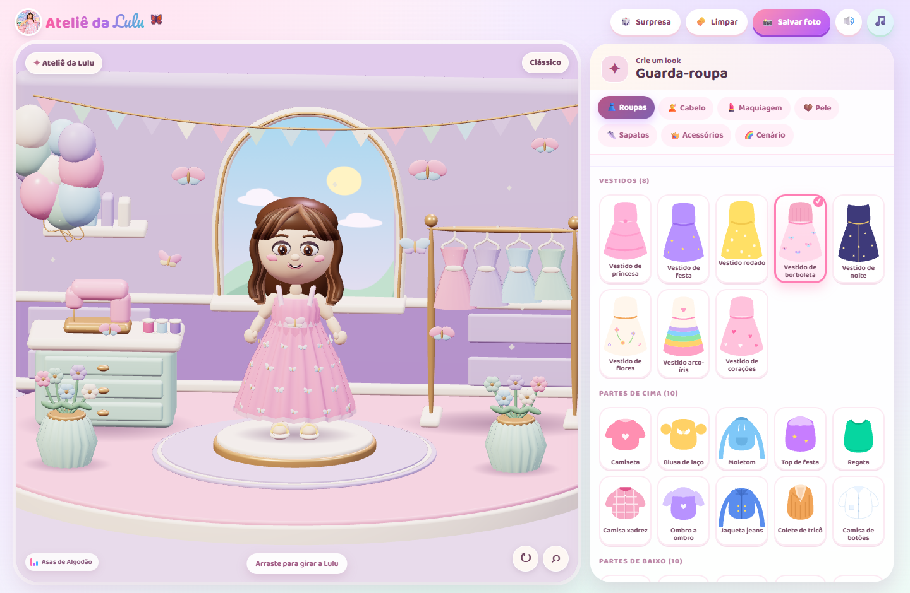

<div align="center">

# 🦋 Ateliê da Lulu 3D

**Um jogo infantil de vestir, criar e brincar no navegador.**

`Blender` · `Three.js` · `Web Audio`

[Como jogar](#como-jogar) · [Bastidores do 3D](#bastidores-do-3d) · [Hospedagem](#hospedagem)

</div>



Entre no ateliê, escolha um look e leve a Lulu para brincar em outro mundo. A foto da Lulu inspirou o vestido de borboletas e a paleta pastel do jogo.

## Como jogar

Com o Node.js instalado, clone o projeto e inicie o servidor local.

```bash
git clone https://github.com/Ald3b4r4n/atelie-da-lulu.git
cd atelie-da-lulu
node server.js
```

Abra [o ateliê](http://localhost:5173/) e clique em **Vamos brincar!** para liberar a música. A versão 3D usa WebGL 2. Se o navegador não oferecer esse recurso, o jogo abre no modo clássico ilustrado.

| No ateliê | O que fazer |
| --- | --- |
| 👗 **Guarda-roupa** | Combine roupas, sapatos, penteados, maquiagem e acessórios. |
| ↻ **Girar e aproximar** | Arraste a Lulu para girá-la ou use os controles da câmera. |
| ✨ **Rosto** | Escolha o formato dos olhos, da boca e do nariz com a câmera aproximada. |
| 🌈 **Cenário** | Explore 20 ambientes 3D, cada um com a sua trilha. |
| 🎲 **Surpresa** | Sorteie um look. Use **Limpar** para voltar ao vestido de borboletas. |
| 📸 **Salvar foto** | Baixe um PNG do look na vista atual. |
| 🎵 **Música** | Ouça **Asas de Algodão**, o tema de abertura com sininhos, harpa e piano. |

## Bastidores do 3D

- [Ateliê e Lulu](blender/atelie.blend) reúne o diorama original, a boneca e as formas faciais.
- [Guarda-roupa](blender/guarda-roupa.blend) reúne as peças usadas na boneca e nas miniaturas.
- [Mundos](blender/mundos.blend) reúne os 19 ambientes adicionais. O jogo carrega cada cenário ao ser selecionado.

Para regenerar os modelos com o Blender 4.5 e recompilar a cena web:

```bash
npm ci
blender --background --python blender/build_atelie.py
blender --background --python blender/build_worlds.py
node blender/export_wardrobe.mjs
blender --background --python blender/build_wardrobe.py
npm run build
```

## Hospedagem

A Vercel usa o `vercel.json` para gerar e publicar a pasta `dist/`. Para gerar a mesma versão e servir em outro host estático, execute `node scripts/build-static.mjs` e publique o conteúdo de `dist/`.
